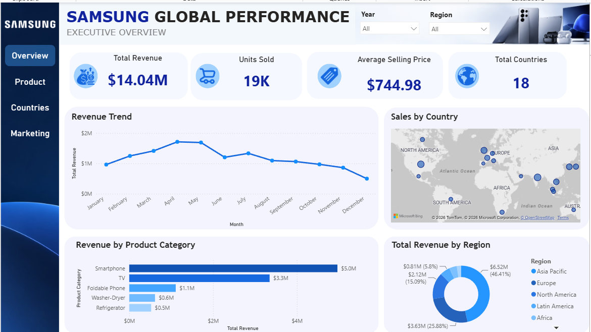
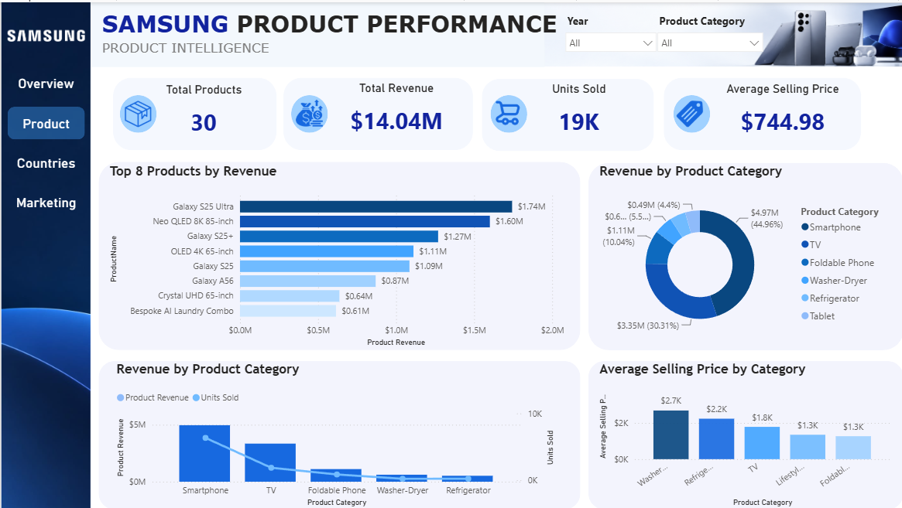
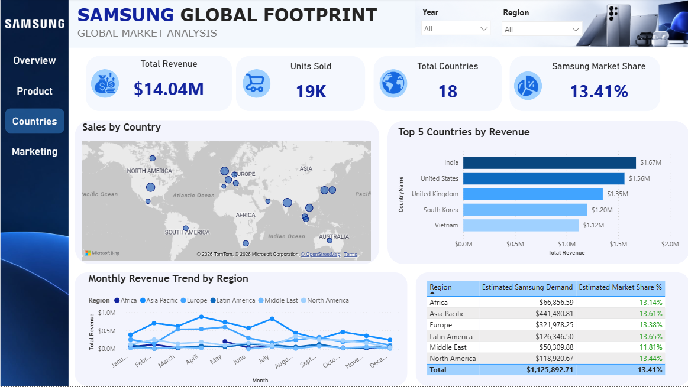
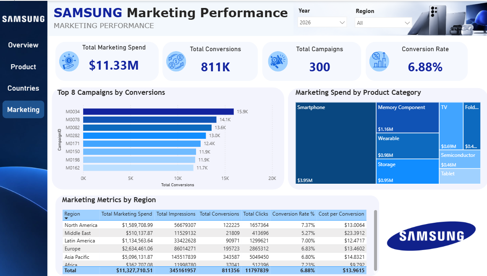

# Samsung Global Performance
### A Power BI Analytics Experience · Sales · Products · Global Markets · Marketing

  <strong>A multi-page business intelligence project exploring Samsung-inspired sales, product performance, global market patterns, and marketing effectiveness.</strong>
   
  Built with Microsoft Power BI, DAX, Power Query, and interconnected CSV datasets.

  
  
  
  

---

## At a glance

This project turns a connected, multi-table dataset into an interactive report designed to answer business questions about revenue, product categories, geographic performance, and campaign efficiency.

**The experience is designed around four questions:**

- **Executive Overview** — How is overall sales performance changing?
- **Product Intelligence** — Which products and categories contribute the most revenue?
- **Global Market Analysis** — How does performance vary between countries and regions?
- **Marketing Performance** — How are marketing budgets, clicks, and conversions performing?

## Dashboard Gallery

The report screenshots are included in the `Screenshot/` folder.

<table>
  <tr>
    <td width="50%">
      <h3 align="center">01 · Executive Overview</h3>
      
      
A high-level view of revenue, units sold, average selling price, monthly trends, and regional performance.

    </td>
    <td width="50%">
      <h3 align="center">02 · Product Intelligence</h3>
      
      
Product rankings, category mix, revenue versus units, and realized average selling price.

    </td>
  </tr>
  <tr>
    <td width="50%">
      <h3 align="center">03 · Global Market Analysis</h3>
      
      
Country-level sales, regional revenue trends, and clearly identified synthetic market estimates.

    </td>
    <td width="50%">
      <h3 align="center">04 · Marketing Performance</h3>
      
      
Campaign spend, impressions, clicks, conversions, efficiency metrics, and a product-category treemap.

    </td>
  </tr>
</table>

## What’s inside

| Dashboard page | Focus | Example metrics and visuals |
|---|---|---|
| **Executive Overview** | Overall business performance | Total Revenue, Units Sold, Average Selling Price, Countries with Sales, revenue trend, country map |
| **Product Intelligence** | Product and category analysis | Top products by revenue, category revenue share, units vs. revenue, average selling price |
| **Global Market Analysis** | Geographic and regional performance | Sales by country, top countries, regional revenue trend, estimated market indicators |
| **Marketing Performance** | Campaign effectiveness | Marketing spend, impressions, clicks, conversions, CTR, conversion rate, CPC, cost per conversion, treemap |

## Dataset

The project uses five linked CSV files. The practice data is synthetic and intended for dashboard development and learning.

| File | Rows | Purpose |
|---|---:|---|
| `Samsung_Products.csv` | 30 | Product catalogue and categories |
| `Samsung_Countries.csv` | 18 | Country, region, currency, and market classification |
| `Samsung_Sales.csv` | 900 | Dates, products, countries, units, prices, discounts, and revenue |
| `Samsung_Marketing.csv` | 300 | Campaign spend, impressions, clicks, and conversions |
| `Samsung_Country_Market_Monthly.csv` | 594 | Monthly category demand and estimated market indicators |

**Total: 1,842 data rows across five CSV files.**

The CSV files are in `Data/`. See [the data dictionary](Samsung_PowerBI_Documentation/docs/DATA_DICTIONARY.md) for field definitions and suggested data types.

## Data model

The model is designed around shared dimensions filtering fact tables:

- `Samsung_Products[ProductID]` → Sales and Marketing
- `Samsung_Countries[CountryID]` → Sales, Marketing, and Monthly Market
- `Calendar[Date]` → Sales and Marketing dates, where configured

Use one-to-many relationships and single-direction filtering from dimensions to facts. Review [the relationship diagram](Samsung_PowerBI_Documentation/docs/RELATIONSHIP_DIAGRAM.md) before recreating the model.

## DAX & analytics

Measures cover sales performance, product mix, time intelligence, market estimates, and campaign efficiency.

| Area | Example measures |
|---|---|
| Sales | Total Revenue, Units Sold, Average Selling Price, Revenue YoY Growth |
| Product | Total Products, Products Sold, Revenue Share %, Units Share % |
| Marketing | Total Marketing Spend, Total Clicks, Total Conversions, CTR, Conversion Rate |
| Efficiency | Cost per Click, Cost per Conversion, Average Spend per Campaign |
| Market estimates | Estimated Category Demand, Estimated Samsung Demand, Estimated Market Share % |

See [DAX Measures Reference](Samsung_PowerBI_Documentation/docs/DAX_MEASURES.md) for formulas and formatting guidance.

## Tools & techniques

- **Microsoft Power BI Desktop** — interactive reports and visuals
- **Power Query** — data preparation and import
- **DAX** — measures and time-based calculations
- **Data modeling** — dimension/fact relationships
- **Visual analytics** — cards, bar charts, line charts, donut charts, maps, tables, and treemaps
- **GitHub** — project documentation and version control

## Getting started

1. Download or clone this repository.
2. Open `Samsung_Global_Performance.pbix` in Power BI Desktop, if the report file is included.
3. If rebuilding the report, import the CSV files from `Data/` using **Home → Get Data → Text/CSV**.
4. Create the relationships described in [Relationship Diagram](Samsung_PowerBI_Documentation/docs/RELATIONSHIP_DIAGRAM.md).
5. Add or validate the measures in [DAX Measures Reference](Samsung_PowerBI_Documentation/docs/DAX_MEASURES.md).
6. Explore the report using the Year, Region, and Product Category slicers.

If Power BI requests a source path on another computer, update the Power Query file paths to point to that computer's local `Data/` folder.

## Design system

The four pages share a restrained, consistent visual language.

| Use | Color | Hex |
|---|---|---|
| Sidebar and headings | Navy | `#0B1F42` |
| Primary charts and highlights | Samsung-inspired blue | `#1769E0` |
| Canvas | Light blue-gray | `#F3F6FB` |
| Cards and visual surfaces | White | `#FFFFFF` |

Design principles: clear hierarchy, generous whitespace, consistent navigation, subtle card treatment, restrained color use, and interactive filtering.

## Data disclaimer

This is an independent educational portfolio project. It is **not affiliated with, endorsed by, or sponsored by Samsung Electronics**.

Product names and categories are Samsung-inspired. Transaction values, prices, discounts, marketing results, demand, and market-share estimates are simulated and **are not official Samsung business data**.

The Sales and Marketing tables do not include campaign-attributed revenue. Therefore, this project does not claim actual marketing ROI/ROAS or causal campaign impact. Market-share measures are synthetic estimates and must be described as such.

## Future improvements

- Refine accessibility, tooltips, drill-through, and date-filter behavior.
- Add campaign-attributed revenue/profit data to support valid ROAS or ROI calculations.
- Replace practice market estimates with appropriately sourced and licensed data.
- Add a short project walkthrough and final screenshots.

## Author

**Rishabh Chaudhary**  
Data Science & AI Learner · Power BI · Data Analytics · Business Intelligence

---

  Built with Microsoft Power BI · Designed for interactive business intelligence

