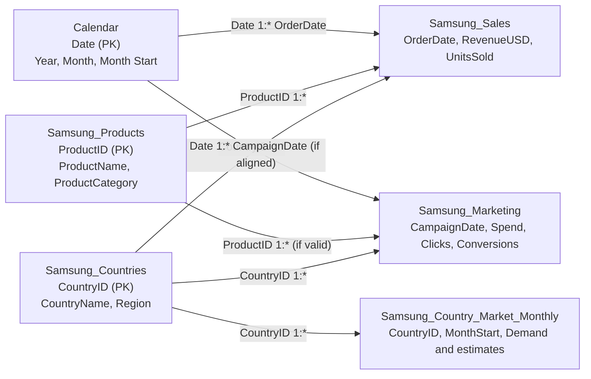

# Relationship Diagram

## Recommended model

Use dimension tables to filter fact tables. Prefer active one-to-many (`1:*`) relationships and single-direction filtering from dimensions to facts.

## Relationships to create

| Dimension key | Fact foreign key | Cardinality | Filter direction |
|---|---|---|---|
| `Samsung_Countries[CountryID]` | `Samsung_Sales[CountryID]` | One-to-many | Single |
| `Samsung_Products[ProductID]` | `Samsung_Sales[ProductID]` | One-to-many | Single |
| `Samsung_Countries[CountryID]` | `Samsung_Marketing[CountryID]` | One-to-many | Single |
| `Samsung_Products[ProductID]` | `Samsung_Marketing[ProductID]` | One-to-many, only if keys are valid | Single |
| `Samsung_Countries[CountryID]` | `Samsung_Country_Market_Monthly[CountryID]` | One-to-many | Single |
| `Calendar[Date]` | `Samsung_Sales[OrderDate]` | One-to-many | Single |
| `Calendar[Date]` | `Samsung_Marketing[CampaignDate]` | One-to-many, if date columns align | Single |

## Date-model notes

The monthly market table uses `MonthStart`. A daily Calendar can relate to the first day of each month, but market rows will only occur on those month-start dates. For a Year slicer that controls Sales, Marketing, and market estimates consistently, design a shared date selection carefully or use synchronized calendar slicers.

## Avoid these pitfalls

- Do not connect Sales directly to Marketing just to make visuals interact.
- Avoid bidirectional filtering unless a specific need has been tested.
- Ensure dimension keys are unique and nonblank.
- Avoid multiple competing active date paths.
- Confirm `CampaignID` is not assumed unique per row; it may repeat across countries, products, or dates.
- If a dimension key is duplicated, clean the dimension or model the correct grain instead of forcing many-to-many relationships.
